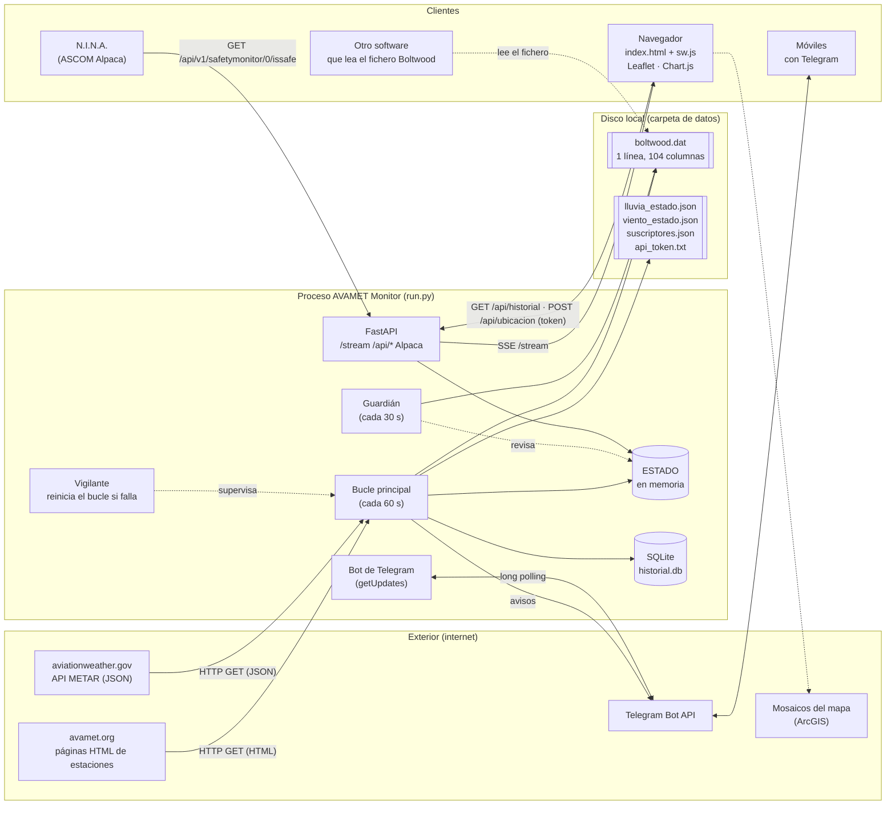
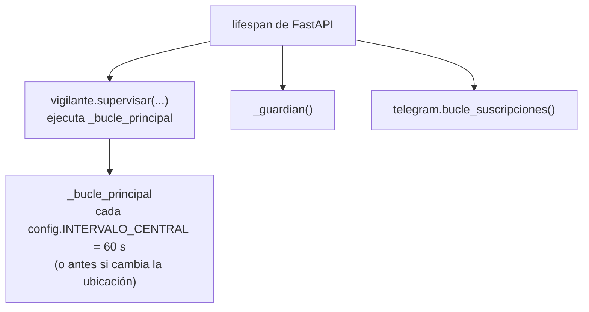
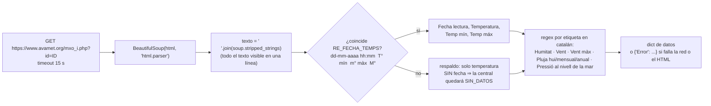
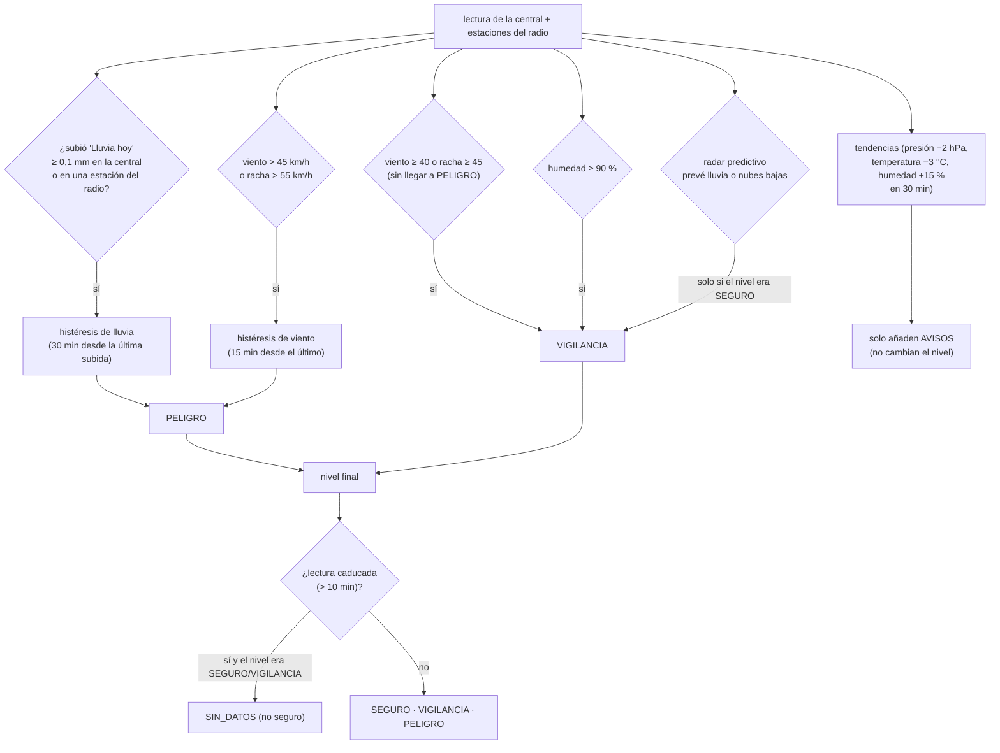
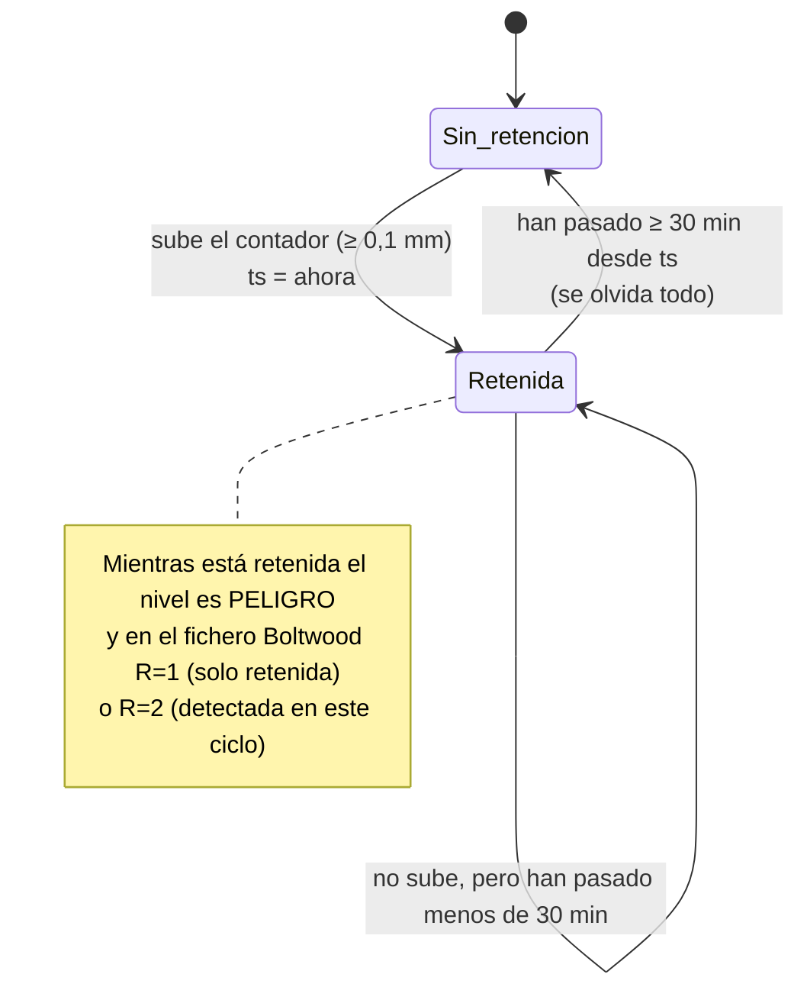
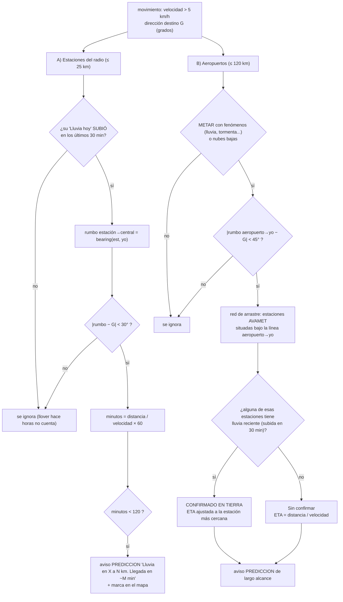
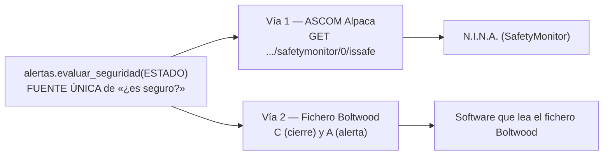
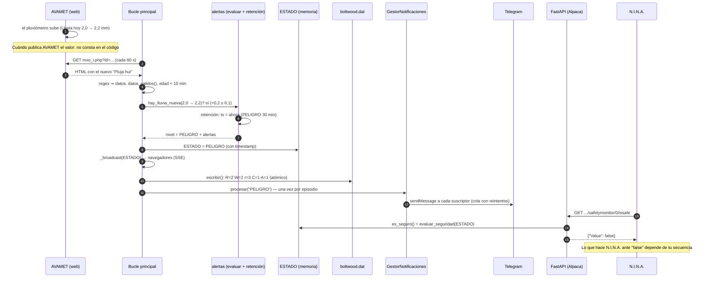
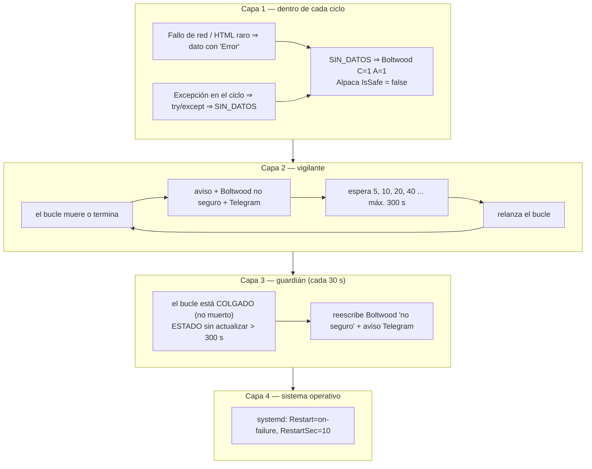
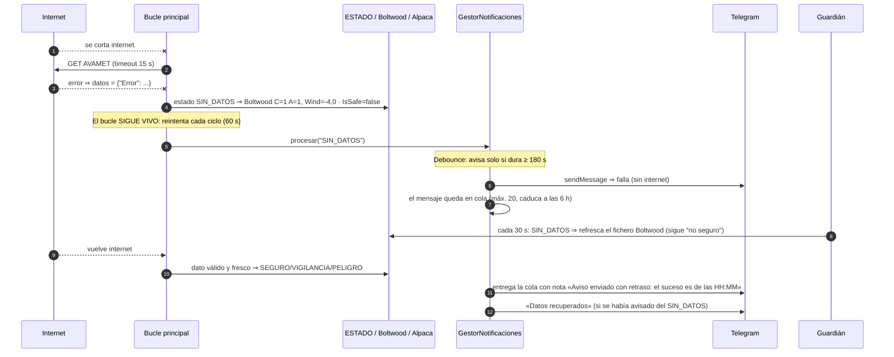

# AVAMET Monitor — Manual técnico

Versión del documento: 1 de noviembre de 2026. Describe cómo funciona el sistema **por dentro**, tal como está
escrito el código en este momento.

> **Cómo leer este manual.** Cada afirmación sobre el comportamiento del programa sale del código (se indica el
> fichero). Lo que depende de software o hardware que **no controla este proyecto** (N.I.N.A., tu controlador del techo,
> la web de AVAMET, Telegram) se marca como **«No puedo confirmar»** o se cita la fuente pública consultada.
> Los diagramas están en [Mermaid](https://mermaid.js.org/) (GitHub y la mayoría de editores Markdown los dibujan).

## Índice

1. [Arquitectura general](#1-arquitectura-general)
2. [Interacción con AVAMET (scraper e histéresis)](#2-interacción-con-avamet)
3. [Interacción con los aeropuertos (METAR) y radar predictivo](#3-interacción-con-los-aeropuertos-metar-y-radar-predictivo)
4. [Interacción con N.I.N.A.: fichero Boltwood y ASCOM Alpaca](#4-interacción-con-nina)
5. [Flujo de seguridad de extremo a extremo](#5-flujo-de-seguridad)
6. [Gestión de fallos: vigilante, guardián y corte de internet](#6-gestión-de-fallos)
7. [Límites conocidos y puntos que no puedo confirmar](#7-límites-conocidos-y-puntos-no-confirmados)
8. [Fuentes](#8-fuentes)
9. [Apéndice: mapa de ficheros y parámetros](#9-apéndice)

---

## 1. Arquitectura general

AVAMET Monitor es **un único proceso Python** (`run.py`) que arranca un servidor web FastAPI/uvicorn. Dentro de ese
proceso viven tres tareas asyncio de fondo y los endpoints HTTP. No hay base de datos externa ni cola de mensajes:
el estado actual está en memoria (`main.ESTADO`) y solo se escribe en disco lo que debe sobrevivir a un reinicio.



### 1.1 Frontend ↔ Backend

| Elemento | Qué hace | Dónde |
|---|---|---|
| `GET /` | Sirve `index.html` con `__BUILD__` sustituido por una huella del contenido del frontend (cache-busting), siempre con `Cache-Control: no-cache`. | `main.py`, `estaticos.py` |
| `GET /sw.js` | Service Worker con el mismo sello; `CACHE_NAME = 'avamet-<huella>'`. Al cambiar un fichero, cambia la huella y el navegador renueva su caché. | `estaticos.py`, `frontend/sw.js` |
| `GET /vendor/...` | Leaflet y Chart.js locales (funciona sin internet). Ruta validada contra salidas de carpeta (`..`, enlaces simbólicos). | `estaticos.py` |
| `GET /stream` | **Server-Sent Events**: al conectar manda el `ESTADO` actual y luego uno nuevo en cada ciclo. Es lo que pinta toda la interfaz. | `main.stream` |
| `GET /api/historial` | Últimas 24 h de la estación central (para la gráfica). | `database.obtener_historial_24h` |
| `GET /api/localidades` | Catálogo de estaciones para el buscador. | `main.py` |
| `POST /api/ubicacion` | Cambia la estación central de **todo el sistema**. Exige token Bearer. | `main.api_ubicacion` |
| `POST /api/shutdown` | Apaga la aplicación (escribe el estado `APAGADO` en el fichero Boltwood antes de salir). Exige token. | `main.apagar_servidor` |
| `/management/*`, `/api/v1/safetymonitor/0/*` | Dispositivo ASCOM Alpaca «SafetyMonitor» (sección 4). **Sin autenticación.** | `main.py` |

El token (`api_token.txt` o `AVAMET_API_TOKEN`) protege solo `/api/shutdown` y `/api/ubicacion`; con 5 intentos fallidos
por IP en 300 s se responde 429. **El resto de endpoints, incluido Alpaca, no tiene autenticación**: no expongas el
puerto a internet.

### 1.2 Backend ↔ exterior

* **AVAMET:** peticiones HTTP GET a páginas HTML (no hay API oficial). Ver sección 2.
* **aviationweather.gov:** una petición JSON por ciclo con todos los aeropuertos cercanos. Ver sección 3.
* **Telegram:** `requests` hacia `api.telegram.org`. El bot consulta con `getUpdates` (long polling de 20 s) en un
  hilo *demonio*, para que un cierre de la aplicación no se quede esperando a esa petición.
* **Disco:** `boltwood.dat` (escritura atómica: fichero temporal + `os.replace`), estados de retención en JSON,
  suscriptores de Telegram, `historial.db` (SQLite, 48 h de historia; marcas de tiempo en UTC).

### 1.3 Tareas de fondo (creadas en el `lifespan` de FastAPI)



Al apagar, el `lifespan` cancela las tres, espera hasta 3 s a que terminen de cancelarse y escribe el estado
`APAGADO` en el fichero Boltwood. Los hilos de red ya lanzados no se pueden interrumpir; `run.py` termina el proceso
con `apagado.terminar_ya()` (`TerminateProcess` en Windows, `os._exit` en el resto) cuando uvicorn ya ha cerrado.

---

## 2. Interacción con AVAMET

### 2.1 El scraper (`backend/avamet.py`)

No hay API: se descarga la página de cada estación y se interpreta su texto.



BeautifulSoup se usa solo para convertir el HTML en texto; los valores se extraen con **expresiones regulares** sobre
ese texto (por eso un cambio de redacción en la web de AVAMET rompe la lectura; ver 2.4).

Ejemplo de texto real citado en el código: `01-11-2026 05:25 15,1° mín 15,1° màx 17,7° Humitat 90 %`. El primer
valor es la **temperatura actual** (comprobado por el usuario el 1-nov-2026 contra la web de AVAMET), no el mínimo.

| Clave en el diccionario | Etiqueta buscada en la página | Notas |
|---|---|---|
| `Fecha lectura` | `dd-mm-aaaa hh:mm` | Hora local de la estación (`AVAMET_TZ`, por defecto `Europe/Madrid`). **Obligatoria**: sin ella no se puede saber la edad del dato. |
| `Temperatura` / `Temp mín` / `Temp máx` | primer, segundo y tercer valor con `°` | La coma decimal se convierte en punto. |
| `Humedad` | `Humitat NN %` | |
| `Viento` | `Vent NN km/h DIR` | `DIR` = abreviatura (p. ej. `ONO`). |
| `Viento máximo` | `Vent màx NN km/h` | Racha. |
| `Lluvia hoy` | `Pluja hui NN mm` | **Acumulado del día**: es un contador que sube. Toda la detección de lluvia se basa en que **suba**. |
| `Lluvia mensual` / `Lluvia anual` | `Pluja mensual/anual` | Informativos. |
| `Presión` | `Pressió al nivell de la mar NNNN hPa` | Solo vale entre 850 y 1100 hPa. Fuera de rango se descarta y queda `Presión descartada` (aviso, no cambia el nivel). La presión **no es imprescindible**. |

`datos_validos()` exige `Temperatura`, `Humedad` y `Fecha lectura` y que no haya `Error`. Si falta algo, la lectura de la
central se trata como **SIN_DATOS** (no seguro).

**Frescura del dato.** `edad_lectura_s()` compara la `Fecha lectura` con la hora actual: si pasa de
`EDAD_MAX_DATOS_S = 600` s (10 min), el dato está *caducado*; una fecha en el futuro (más de 5 min) también se rechaza,
porque indicaría una zona horaria mal configurada.

### 2.2 Qué se consulta y cada cuánto

| Qué | Frecuencia | Cómo |
|---|---|---|
| Estación central | cada `INTERVALO_CENTRAL` = **60 s** | 1 petición |
| Estaciones del radio (por defecto 25 km) | cada `INTERVALO_RADIO` = **180 s** (se reutiliza la caché entre medias) | hasta 10 peticiones en paralelo (`ThreadPoolExecutor`) |
| Guardado en historial (SQLite) | cada 300 s | `database.guardar_lectura` |

Cuántas veces actualiza AVAMET sus estaciones **no está en el código y no puedo confirmarlo**; el sistema solo ve lo
que AVAMET publica en cada momento y usa su `Fecha lectura` para saber cuán viejo es.

### 2.3 Del dato al nivel: `alertas.evaluar()`



Umbrales (`backend/config.py`): viento sostenido PELIGRO `> 45` km/h, racha PELIGRO `> 55` km/h, VIGILANCIA
`≥ 40` / `≥ 45`; humedad `≥ 90 %`. **VIGILANCIA se considera seguro** (N.I.N.A. sigue recibiendo «seguro»); solo
PELIGRO, SIN_DATOS, INICIANDO, ERROR o APAGADO son *no seguro*.

### 2.4 La retención («histéresis»)

**Problema que resuelve.** La lluvia se detecta cuando el contador `Lluvia hoy` **sube**. Un instante después el
contador deja de subir; sin memoria, el sistema volvería a SEGURO a los pocos segundos de empezar a llover, y el techo
se abriría y cerraría con cada intermitencia. La retención mantiene PELIGRO durante un tiempo fijo **desde el último
incremento**.

Se implementa con funciones puras en `alertas.py` (probadas sin red):



* **Lluvia:** `actualizar_retencion_lluvia()`. Un incremento se define en `hay_lluvia_nueva()`:
  `round(actual − anterior, 2) ≥ 0,1` mm. **Sin lectura anterior (arranque, tras un error, estación nueva) nunca cuenta
  como lluvia nueva** (evita falsas alarmas). El plazo es `RETENCION_LLUVIA_S = 30 × 60` s.
* **Viento:** `actualizar_retencion_viento()`. Cada ciclo con viento/racha en PELIGRO fija `ts = ahora`; PELIGRO se
  mantiene `RETENCION_VIENTO_S = 15 × 60` s desde el último. Las rachas que oscilan alrededor del umbral no abren y
  cierran el techo.
* **Persistencia:** `lluvia_estado.json` y `viento_estado.json` guardan el instante y *dónde* fue. Si la aplicación se
  reinicia en plena tormenta, **recupera la retención** en lugar de arrancar «limpia». El fichero incluye el id de la
  estación; si cambia la ubicación, no se arrastra a otra estación.
* **Cambio de ubicación (anti-carrera):** `api_ubicacion` pone `ESTADO = INICIANDO` y escribe «no seguro» en Boltwood
  *antes* de nada, y el bucle descarta cualquier ciclo que hubiera empezado con la estación anterior (`_ubicacion_cambio`).

Ejemplo con números (lluvia): contador 2,0 mm a las 14:00 → 2,2 mm a las 14:01 (+0,2 ≥ 0,1) ⇒ PELIGRO, `ts = 14:01`.
A las 14:20 el contador sigue en 2,2 mm; han pasado 19 min < 30 ⇒ sigue PELIGRO («retenido: última lluvia hace 19 min»).
A las 14:31 han pasado 30 min ⇒ se olvida y vuelve SEGURO (si nada más lo impide).

### 2.5 Qué puede salir mal con el scraper

* Si AVAMET cambia el texto de la página (p. ej. renombra «Pluja hui»), la regex no encuentra el campo: el diccionario no
  lo trae. Si falta algo obligatorio ⇒ SIN_DATOS (falla hacia el lado seguro). Si falta solo la lluvia, no hay error
  visible pero **no se detecta lluvia**: es el punto más delicado; lo mitiga que existen las estaciones del radio.
* Estación sin lectura nueva > 10 min ⇒ dato caducado ⇒ SIN_DATOS.

---

## 3. Interacción con los aeropuertos (METAR) y radar predictivo

### 3.1 Consulta a `aviationweather.gov` (`backend/aeropuertos.py`)

```
GET https://aviationweather.gov/api/data/metar?ids=LECH,LEVC,...&format=json     (timeout 15 s)
```

* La lista de aeropuertos está **fija en el código** (`AEROPUERTOS`: 35 ICAO españoles con latitud y longitud).
  `buscar_aeropuertos_cercanos()` conserva los que estén a ≤ **120 km** de la estación central (distancia de
  Haversine), ordenados por cercanía.
* Una única petición con todos los ICAO. De cada METAR se usan: `temp`, `dewp` (punto de rocío), `wspd` (nudos),
  `wdir` (grados), `visib`, `clouds`, `wxString` y `reportTime`.
* `User-Agent`: `AVAMET-Monitor/1.0 (observatorio astronomico)`; si defines `AVAMET_CONTACTO` (p. ej. un correo) se
  añade. No se inventa ningún contacto.
* **Regla de oro:** un dato que no se entiende **no es cero**. `VRB` (viento variable), vacío o ausente ⇒ `None`
  (0° sería «Norte»; 0 °C parecería una temperatura real). El 0 de verdad (calma, 0 °C) se conserva como 0.
* Nubosidad (`traducir_nubosidad`): según la base de la capa, **baja** si < 2000 m, **media** si < 6000 m, **alta** si
  ≥ 6000 m (1 ft = 0,3048 m). `SKC/CLR/NSC` se ignoran.
* Fenómenos (`wxString`): se traducen códigos (`RA` lluvia, `TS` tormenta, `SH` chubascos, `DZ` llovizna, etc.).
  «Tiempo malo» = cualquier fenómeno distinto de «Ninguno».

Los METAR son boletines de observación **de superficie** de cada aeropuerto (se actualizan, normalmente, cada hora o
media hora; no puedo confirmar la cadencia de cada aeropuerto).

### 3.2 «Dirección del viento en altura»: qué se calcula realmente

**Importante, para no engañarse:** el programa **no tiene viento en altura**. Usa el **viento de superficie** de la
estación central (AVAMET) y el de los METAR de aeropuertos cercanos, y supone que las nubes se desplazan en esa
dirección. Eso es una **aproximación** (el viento a la altura de las nubes puede diferir de forma notable del de
superficie); el código no lo corrige ni lo valida. *No puedo confirmar que sea una buena aproximación en tu zona.*

`movimiento.estimar_movimiento_nubes()` (módulo puro, con tests):

1. Se construye una lista de puntos `{distancia, velocidad km/h, dirección origen en grados}`:
   * la **central** (distancia fija 0,1 km), si `Viento` es del tipo `NN km/h DIR` y `DIR` se reconoce (`ONO` → 292,5°);
   * cada **aeropuerto** con velocidad **y** dirección no nulas (nudos × 1,852 = km/h).
2. Cada punto es un vector y **todos pesan igual** (media simple). Con `rad = radians(dir)`:
   `u = −vel·sin(rad)`, `v = −vel·cos(rad)` (el signo menos pasa de «de dónde viene» a «hacia dónde va»).
3. Se promedian: `u̅ = Σu/n`, `v̅ = Σv/n` (n = número de puntos válidos).
4. `velocidad = √(u̅² + v̅²)`; `dir_origen = atan2(−u̅, −v̅)` normalizada a 0–360°; `dir_destino = dir_origen + 180°`.
5. Categoría: < 10 km/h *Lento*, < 30 *Moderado*, resto *Rápido*. Si no hay ningún punto válido:
   «No estimable», velocidad 0.

**Ejemplo calculado** (valores inventados, cuentas reales del código): central `12 km/h ONO`; LECH a 22 km con 10 kt
desde 270°; LEVC a 60 km con 5 kt desde 250°.

| Punto | dist (km) | vel (km/h) | dir origen | peso |
|---|---|---|---|---|
| Central | 0,1 | 12,00 | 292,5° | 1 |
| LECH | 22 | 18,52 (10 × 1,852) | 270° | 1 |
| LEVC | 60 | 9,26 (5 × 1,852) | 250° | 1 |

Resultado: `u̅ = 12,769`, `v̅ = −0,475`, velocidad **12,8 km/h**, dirección de origen 272,1°, destino 92° ⇒ **E**,
categoría *Moderado*.

> **Nota.** Antes el peso era `1/distancia²`: con la central a 0,1 km pesaba
> unas 48 000 veces más que un aeropuerto a 22 km, y una central **en calma** arrastraba la velocidad media a casi 0
> (< 5 km/h ⇒ el radar quedaba apagado) aunque un aeropuerto lejano tuviera tormenta y viento hacia nosotros. Se
> descartó `1/distancia` porque seguía siendo ~800 a 1 (central a 0,1 km frente a un aeropuerto a 80 km). Con la media
> simple, una central en calma (0 km/h con dirección) y un aeropuerto a 80 km con 20 kt (37 km/h) del SO dan
> **18,5 km/h hacia el NE**: el radar se activa.
>
> **Contrapartida asumida.** Un aeropuerto a 120 km cuenta lo mismo que la estación de tu observatorio, y una central en
> calma *diluye* la velocidad: en el ejemplo anterior la velocidad real del aeropuerto es 37 km/h pero se usa 18,5, así
> que el **tiempo de llegada estimado sale ~2 veces más largo** (259 min en lugar de ~130). Detecta la tormenta, pero
> la hora de llegada es pesimista en el sentido de «tarde».

### 3.3 Radar predictivo: ¿viene la lluvia hacia nosotros?

Solo actúa si la velocidad estimada es **> 5 km/h**. Hay dos variantes, y ambas **solo pueden subir el nivel de
SEGURO a VIGILANCIA** (nunca a PELIGRO):



Detalles de cálculo:

* **Rumbo** (`_bearing`): fórmula estándar de rumbo inicial entre dos puntos: `y = sin(Δλ)·cos(φ₂)`,
  `x = cos(φ₁)·sin(φ₂) − sin(φ₁)·cos(φ₂)·cos(Δλ)`, `rumbo = atan2(y, x)` normalizado a 0–360°.
* **Estaciones del radio:** se compara el rumbo *desde la estación hacia la central* con la dirección hacia la que van
  las nubes. Si difieren menos de 30°, la estación está «a favor del viento» y la lluvia que registre podría llegar.
* **Aeropuertos:** el umbral angular es 45°. La **red de arrastre** (`_procesar_red_arrastre`) proyecta cada estación
  AVAMET sobre la recta aeropuerto→central; se queda con las que caen entre el 10 % y el 90 % del trayecto
  (`0,1 < t < 0,9`) y a menos de **15 km** de la recta, separadas al menos 8 km entre sí (máximo 6), y lee su lluvia.
  Para estimar tiempos usa como mínimo 10 km/h de velocidad.
* **Cuenta solo la lluvia que SUBE.** Una estación solo cuenta si su `Lluvia hoy` **subió ≥ 0,1 mm en
  los últimos 30 min** (`alertas.registrar_lluvia_estacion` / `lluvia_reciente`); antes bastaba con tener algo
  acumulado «hoy». La primera lectura de una estación solo fija la línea base. **El seguimiento no se guarda en disco**:
  tras reiniciar, una estación no cuenta hasta que vuelva a subir.

Ejemplo: central en (39,94; −0,05), viento hacia 112° (ESE) a 12 km/h. Una estación a 11,0 km al ONO (rumbo
estación→central ≈ 112,1°) cuyo contador acaba de subir: diferencia ≈ 0,1° < 30° ⇒ minutos = 11,0 / 12 × 60 ≈ **55 min
< 120** ⇒ aviso «Llegada en ~55 min» y nivel VIGILANCIA (si no había otro motivo de PELIGRO).

> **Matiz.** Si esa estación del radio (≤ 25 km) acaba de registrar un incremento de lluvia, `evaluar()` ya pone
> **PELIGRO** por lluvia en el radio. El aviso predictivo aporta entonces el *tiempo estimado de llegada*; su efecto en
> el nivel solo se nota cuando no hay otro motivo de PELIGRO.

---

## 4. Interacción con N.I.N.A.

El proyecto ofrece a los programas de astrofotografía **dos vías independientes** con la misma decisión de seguridad:



Ambas usan **la misma función** (`alertas.evaluar_seguridad`), de modo que no pueden contradecirse.

### 4.1 La decisión: `evaluar_seguridad()`

Devuelve `(seguro, motivo)`:

| Motivo | Condición | ¿Seguro? |
|---|---|---|
| `OK` | datos frescos y nivel SEGURO o VIGILANCIA | **sí** |
| `NIVEL` | datos frescos pero nivel PELIGRO | no |
| `SIN_DATOS` | estado INICIANDO / ERROR / SIN_DATOS / APAGADO, o lectura incompleta | no |
| `DATO_CADUCADO` | la `Fecha lectura` tiene más de 600 s (10 min) | no |
| `CICLO_CADUCADO` | el bucle principal no actualiza `ESTADO` desde hace `5 × 60 = 300` s | no |

### 4.2 Vía 1: ASCOM Alpaca (`/api/v1/safetymonitor/0/issafe`)

El programa se anuncia como un dispositivo Alpaca de tipo **SafetyMonitor** (número 0, `UniqueID`
`avamet-safetymonitor-001`). Endpoints implementados (`main.py`): `/management/apiversions`,
`/management/v1/description`, `/management/v1/configureddevices` y, bajo `/api/v1/safetymonitor/0/`:
`issafe`, `connected` (GET/PUT), `connecting`, `disconnecting`, `description`, `driverinfo`, `driverversion`,
`interfaceversion`, `name`, `supportedactions`.

Petición y respuesta típicas (con el dispositivo ya **conectado**, ver más abajo):

```
GET http://IP-DEL-EQUIPO:8000/api/v1/safetymonitor/0/issafe?ClientID=1&ClientTransactionID=42

{"Value": true, "ErrorNumber": 0, "ErrorMessage": "", "ClientTransactionID": 42, "ServerTransactionID": 731205}
```

* `Value` es `es_seguro()`: `true` ⇒ seguro; `false` ⇒ no seguro. Se calcula **al momento** sobre el `ESTADO` en memoria,
  con la fecha actual, así que un dato que caduca entre ciclos se refleja en la siguiente consulta aunque el bucle esté
  parado.
* `ClientTransactionID` se devuelve tal cual; si falta, no es numérico o es negativo se devuelve 0 (antes un valor no
  numérico provocaba un error 500). El nombre del parámetro no distingue mayúsculas.
* Cada consulta a `issafe` **respondida** anota la hora (`_NINA_ULTIMO_PING`); si la última fue hace menos de 15 s, la interfaz muestra
  el indicador **N.I.N.A.** en verde (significa «alguien está consultando», no necesariamente N.I.N.A.).

**Conexión ASCOM.** La documentación ASCOM de `IsSafe` indica que la propiedad lanza
`NotConnectedException` «si el dispositivo no está conectado» ([ASCOM, `ISafetyMonitor.IsSafe`](#8-fuentes)). Ahora:

* Al arrancar, el dispositivo está **desconectado**. `GET connected` devuelve `false`.
* El cliente conecta con `PUT .../connected` y cuerpo `Connected=True` (`application/x-www-form-urlencoded`; el nombre
  del parámetro no distingue mayúsculas; un valor ausente o distinto de True/False da **HTTP 400** en texto plano).
  Con `Connected=False` se desconecta.
* Mientras no esté conectado, `GET .../issafe` responde **HTTP 200** con `ErrorNumber = 1031` (0x407, *NotConnected*), un
  `ErrorMessage` y **sin `Value`**: nunca un `true` ni un `false` falsos. (En Alpaca, un resultado de dispositivo va con HTTP 200
  y el error en el JSON; 0x407 = 1031 según la [referencia Alpaca de ASCOM](#8-fuentes).)
* El estado de conexión es **único para todo el dispositivo** (no por `ClientID`) y **se pierde al reiniciar la
  aplicación**: tras un reinicio, el cliente debe volver a conectar. Qué hace N.I.N.A. mientras recibe 1031 **no puedo
  confirmarlo**.
* `AVAMET_ALPACA_ESTRICTO=0` restaura el comportamiento anterior (siempre «conectado»), por si un cliente gestiona la
  conexión por su cuenta y nunca envía `PUT connected`. El resto de endpoints (`name`, `description`, `driverinfo`...)
  no exigen conexión.
* El indicador **N.I.N.A.** de la interfaz solo se enciende cuando `IsSafe` se **responde** (no con las peticiones
  rechazadas). En el log aparece, como máximo una vez por minuto, «IsSafe rechazado (NotConnected)».

### 4.3 Cómo usa N.I.N.A. el SafetyMonitor (lo que está documentado)

Lo que **sí** he podido comprobar en fuentes públicas:

* N.I.N.A. permite elegir un *Safety Monitor* ASCOM/Alpaca y mostrar su estado seguro/no seguro; el secuenciador
  avanzado tiene condiciones del tipo «esperar a que el Safety Monitor esté seguro» y una instrucción «Check Safety
  Monitor» ([Backyard Astronomy](#8-fuentes)).
* Si las condiciones pasan a no seguras durante la sesión, N.I.N.A. «puede disparar» acciones de fin de secuencia:
  parar la captura, calentar la cámara, aparcar la montura y cerrar la cúpula o el techo (misma fuente).
* En un bucle condicionado por el Safety Monitor, N.I.N.A. antes terminaba la exposición en curso antes de salir; el
  mantenedor indicó que una versión nocturna posterior cancelaría de inmediato las instrucciones en curso al pasar a no
  seguro ([N.I.N.A. issue #740](#8-fuentes)).

Lo que **no puedo confirmar** (depende de tu instalación):

* **Cada cuánto consulta N.I.N.A. `IsSafe`.** No consta en las fuentes que he consultado.
* **Qué hace exactamente tu secuencia** (si cierra la cúpula/techo, aparca primero, espera, etc.) y **cómo está
  conectado tu controlador del techo.** Eso lo define tu perfil y tus secuencias de N.I.N.A.; este programa solo
  entrega «seguro / no seguro». **Haz una prueba controlada** (p. ej. desconectar la red del equipo unos minutos para
  forzar SIN_DATOS) y comprueba que el techo se cierra.

### 4.4 Vía 2: el fichero `boltwood.dat` (`backend/boltwood.py`)

Emula el *Single Line Data File* del Cloud Sensor II de Boltwood (formato **nuevo**, una línea de **104 columnas**,
sección 17.1.1 del manual del Cloud Sensor II según cita el propio código). Se escribe **en cada ciclo** y siempre
que cambia algo importante (arranque, cambio de ubicación, error, apagado), de forma **atómica** (temporal +
`os.replace`, con CRLF) para que un lector nunca vea media línea. Ruta: `AVAMET_BOLTWOOD_PATH` o
`<carpeta de datos>/boltwood.dat`; se desactiva con `AVAMET_BOLTWOOD=0`.

Línea real generada por el código (SEGURO, con una lectura de ejemplo) y su desglose por columnas:

```
2026-11-01 14:23:11.86 C K    0.0   15.1   15.1   12.0  70    9.7   0 0 0 00131 046327.59944 0 1 1 0 0 0
```

| Campo | Columnas | Valor en el ejemplo | Contenido y origen en AVAMET Monitor |
|---|---|---|---|
| Date | 1-10 | `2026-11-01` | Fecha local (zona `AVAMET_TZ`). |
| Time | 12-22 | `14:23:11.86` | Hora local. |
| T | 24 | `C` | Unidades de temperatura: siempre Celsius. |
| V | 26 | `K` | Unidades de viento: siempre km/h. |
| SkyT | 28-33 | `   0.0` | Temperatura cielo-ambiente. **AVAMET no la mide**: valor sintético según `BOLTWOOD_COND_NUBES` (0→0,0; 1→−30; 2→−15; 3→−5). |
| AmbT | 35-40 | `  15.1` | `Temperatura` de la central. |
| SenT | 41-47 | `   15.1` | Igual que AmbT (no hay sensor de caja). |
| Wind | 49-54 | `  12.0` | `Viento` en km/h. **Negativo = código de fallo** (−4,0 en SIN_DATOS). |
| Hum | 56-58 | ` 70` | `Humedad` %. |
| DewPt | 60-65 | `   9.7` | Punto de rocío calculado (fórmula de Magnus, constantes 17,62 / 243,12). |
| Hea | 67-69 | `  0` | Calentador: siempre 0. |
| R | 71 | `0` | Lluvia: 0 seco · 1 lluvia en el último minuto (**retenida**) · 2 lluvia ahora (**detectada en este ciclo**). |
| W | 73 | `0` | Mojado: mismo código que R. |
| Since | 75-79 | `00131` | Segundos desde la `Fecha lectura` de AVAMET (131 s en el ejemplo); `99999` si no se conoce. |
| Now() | 81-92 | `046327.59944` | Fecha/hora en días «VB6» (desde 1899-12-30). |
| c | 94 | `0` | Nubes: 0 desconocido · 1 despejado · 2 nublado · 3 muy nublado (**no medido**: `BOLTWOOD_COND_NUBES`, por defecto 0). |
| w | 96 | `1` | Viento: 1 calma · 2 ventoso (VIGILANCIA) · 3 muy ventoso (PELIGRO, incluida la retención de 15 min). |
| r | 98 | `1` | Lluvia: 1 seco · 2 mojado (lluvia en el radio) · 3 lluvia (central). |
| d | 100 | `0` | Luz: **no medido** (`BOLTWOOD_COND_LUZ`, por defecto 0). |
| **C** | **102** | `0` | **Cierre de techo solicitado**: `0` si es seguro, **`1` si NO es seguro**. |
| **A** | **104** | `0` | **Alerta**: `1` si no es seguro **o** el nivel es VIGILANCIA; `0` si SEGURO. |

Las posiciones de columna se comprobaron cortando la línea generada por el código en esos rangos.

Combinaciones relevantes (líneas reales generadas por el código):

| Situación | Línea (fragmento relevante) | C · A |
|---|---|---|
| SEGURO | `... 0 0 0 00131 ... 0 1 1 0` **`0 0`** | 0 · 0 |
| VIGILANCIA | `... 0 0 0 00131 ... 0 1 1 0` **`0 1`** | 0 · 1 (sigue siendo seguro) |
| PELIGRO por lluvia en la central | `... 0 2 2 00131 ... 0 1 3 0` **`1 1`** (R=2, W=2, r=3) | 1 · 1 |
| SIN_DATOS / caducado / ciclo caducado / INICIANDO / APAGADO | `2026-.. C K 0.0 0.0 0.0 -4.0 0 0.0 0 0 0 99999 ... 0 0 0 0` **`1 1`** | 1 · 1 |

Fallos de lectura ⇒ `Wind = −4,0` («sensor con fallo» en el formato Boltwood), `Hum = 0` y `C = A = 1`: **se escribe
«no seguro» explícito**, nunca se deja el último valor «seguro». Durante `DATO_CADUCADO` se conserva el `Since` real
para que quien lea vea la antigüedad.

**Cómo lo interpreta quien lee el fichero.** El significado de `C` y `A` (cierre solicitado / alerta) es el definido por
el formato Boltwood. **No puedo confirmar que N.I.N.A. lea este fichero directamente**: N.I.N.A. se integra por Alpaca
(vía 1). El fichero está pensado para otro software que sí lea el formato Boltwood. Que ese software cierre un techo
depende de su configuración, no de este proyecto.

---

## 5. Flujo de seguridad

Camino completo desde que AVAMET publica un aumento de lluvia hasta que N.I.N.A. recibe «no seguro».



El orden dentro de un ciclo es deliberado (`_bucle_principal`): primero el estado y el fichero Boltwood
(lo que mueve al techo), y **después** Telegram, de modo que un Telegram lento o caído nunca retrasa la decisión de
seguridad. Los fallos de Telegram se capturan y no cambian el nivel.

### 5.1 Latencia: cuentas, no promesas

Todo lo que sigue sale de las constantes del código; **no incluye** el retraso de publicación de AVAMET ni el intervalo
de consulta de N.I.N.A. (ambos desconocidos).

| Tramo | Cálculo |
|---|---|
| Detección en la **central** | un ciclo cada 60 s ⇒ como máximo ≈ 60 s hasta el siguiente ciclo, más la duración de ese ciclo (petición con límite de 15 s; con las consultas de radio y METAR puede alargarse algo). |
| Detección en una **estación del radio** | la caché del radio se refresca cuando han pasado ≥ 180 s; como los ciclos son de 60 s, **entre 180 y ~240 s**. |
| Escribir Boltwood y actualizar Alpaca | en el mismo ciclo, inmediatamente tras construir el estado (la escritura es atómica). Alpaca lee `ESTADO` en memoria en cada consulta. |
| Telegram | después de Boltwood, en el mismo ciclo; cada mensaje usa `requests` con límite de 10 s por suscriptor. |

Importante: lo que se detecta es que **el contador suba ≥ 0,1 mm**, no «una gota». La resolución del pluviómetro de
cada estación AVAMET no consta en el código y no puedo confirmarla; si un cubilete tarda en llenarse, el contador
tarda en subir.

---

## 6. Gestión de fallos

### 6.1 Las capas de protección



### 6.2 Si se cae internet en el observatorio

Es el caso más probable de fallo real. Qué ocurre, en orden (valores del código):



Puntos clave:

* **Falla hacia el lado seguro.** Sin datos fiables el sistema dice «no seguro» desde el **primer ciclo fallido** (no
  espera a los 180 s: ese retardo es solo para el *aviso por Telegram*, para no avisar por un único timeout).
* **El vigilante no interviene** en un simple corte de internet, porque el bucle no muere: captura el error y sigue. El
  vigilante cubre *otros* fallos: p. ej. arrancar **sin red y sin catálogo de estaciones** (`_preparar_entorno` falla ⇒
  reintentos con espera creciente 5 → 10 → 20 → … → 300 s; mientras tanto Boltwood dice «no seguro»), o una excepción
  inesperada fuera del `try` del ciclo. Si la ejecución anterior duró ≥ 300 s, la espera vuelve a empezar en 5 s.
* **El guardián cubre el bucle colgado:** si `ESTADO` lleva > 300 s (`5 × INTERVALO_CENTRAL`) sin actualizarse,
  `evaluar_seguridad` da `CICLO_CADUCADO`; el guardián (cada 30 s) reescribe Boltwood «no seguro» y avisa por Telegram.
  También Alpaca pasa a `false` por sí solo, porque calcula con la hora actual.
* **Telegram sin internet es inevitable:** el aviso de SIN_DATOS (justo cuando no hay internet) no puede salir hasta que
  vuelva. Se guarda y se envía después con la hora real del suceso. Si necesitas un aviso local con la red caída, tendría
  que ser otro canal (no existe en este proyecto).
* **Historial y reinicios:** `historial.db` conserva 48 h, las retenciones de lluvia/viento se recuperan de JSON, y el
  catálogo de estaciones se lee de `coordenadas.json` (copia local), por lo que un reinicio sin internet **no pierde**
  esa información.
* **Reloj del equipo:** la edad del dato se calcula con la hora del equipo. Una Raspberry Pi sin RTC que arranque sin red
  puede tener la hora mal hasta sincronizarse; por eso la guía de instalación incluye el apéndice del RTC DS3231.

### 6.3 Resumen de fallos y respuesta

| Fallo | Detección | Respuesta | Aviso |
|---|---|---|---|
| Sin internet / AVAMET caído | `{"Error"}` en la lectura | SIN_DATOS ⇒ no seguro en el primer ciclo | Telegram (tras 180 s; con cola si no hay red) |
| Estación sin datos nuevos > 10 min | `edad_lectura_s` | SIN_DATOS (badge) / `DATO_CADUCADO` | Telegram como SIN_DATOS |
| HTML de AVAMET cambia | faltan campos obligatorios | SIN_DATOS | Telegram |
| Excepción en el ciclo | `try/except` en el bucle | SIN_DATOS (mensaje «Error interno») | Telegram |
| Bucle muerto | `vigilante.supervisar` | no seguro + relanzar con espera creciente | Telegram |
| Bucle colgado | guardián: `CICLO_CADUCADO` | Boltwood «no seguro» (Alpaca ya da `false`) | Telegram |
| Cambio de ubicación | `api_ubicacion` | INICIANDO ⇒ no seguro hasta la 1.ª lectura de la nueva estación | — |
| Apagado de la app | lifespan / `/api/shutdown` | Boltwood `APAGADO` (C=1, A=1) y se bloquea cualquier escritura posterior | — |
| Caída total del proceso/equipo | — | **ninguna dentro del programa**: systemd relanza (`Restart=on-failure`) solo si el proceso muere; con el equipo apagado nadie escribe nada | — |

> **Última línea de defensa fuera del alcance de este programa.** Si el equipo se apaga o se cuelga entero, el fichero
> Boltwood se queda con la última línea escrita (con su `Now()` y `Since` envejeciendo) y Alpaca no responde. Qué hace
> N.I.N.A. o tu controlador ante una consulta que no responde, o ante un fichero viejo, **no puedo confirmarlo**; es
> conveniente que el propio cierre del techo no dependa solo de este programa (final de carrera, temporizador,
> sensor de lluvia local, etc.).

---

## 7. Límites conocidos y puntos no confirmados

1. **Viento de superficie, no en altura.** La estimación de movimiento de nubes usa el viento de estaciones y
   aeropuertos a nivel de superficie (sección 3.2). Es una aproximación.
2. **Media simple del viento** (sección 3.2): un aeropuerto lejano pesa lo mismo que la central, y una central en calma
   diluye la velocidad (detecta, pero la hora de llegada sale pesimista).
3. **El radar predictivo no ve nubes.** Solo detecta lluvia cuando el **contador de un pluviómetro sube** o cuando un
   METAR informa de fenómenos o nubes bajas. Una nube que aún no ha soltado lluvia sobre ninguna estación no se detecta.
4. **El seguimiento del radar no se guarda en disco** (se reinicia con la aplicación).
5. **Alpaca sin autenticación.** El estado «conectado» es único para todo el dispositivo y se pierde al reiniciar (4.2).
6. **Cadencia de publicación de AVAMET, resolución de sus pluviómetros y cadencia de los METAR:** no constan en el código.
7. **Comportamiento de N.I.N.A.** (frecuencia de consulta, qué hace con `false`, cómo cierra tu techo): depende de tu
   instalación. Verifica con una prueba controlada.
8. **¿Lee N.I.N.A. el fichero Boltwood?** No puedo confirmarlo; la integración documentada es por Alpaca.
9. **Todo el sistema se ha probado con simulaciones y tests unitarios;** FastAPI/uvicorn reales, el empaquetado
   PyInstaller y la Raspberry Pi real no se han ejecutado en el entorno de desarrollo del asistente. Tus pruebas
   en el observatorio son la validación real.
10. **`/pueblo` por Telegram** (solo el administrador, `AVAMET_ADMIN_CHAT_ID`) cambia la estación de seguridad para todos.

---

## 8. Fuentes

* ASCOM Platform — `ISafetyMonitor.IsSafe`: <https://ascom-standards.org/Help/Platform/html/P_ASCOM_DeviceInterface_ISafetyMonitor_IsSafe.htm>
  («Indicates whether the monitored state is safe for use»; «Must be implemented»; lanza `NotConnectedException` si no
  está conectado).
* Backyard Astronomy, *NINA Weather and Safety Monitoring* (30-ago-2026):
  <https://www.backyardastronomy.net/2026/08/30/nina-weather-and-safety-monitoring-protecting-your-equipment-while-you-sleep/>
* N.I.N.A. issue #740, *Loop when SafetyMonitor != True does not cancel immediately*:
  <https://bitbucket.org/Isbeorn/nina/issues/740/loop-when-safetymonitor-true-does-not>
* Boltwood Cloud Sensor II — manual del usuario, sección 17.1.1 «New Format» (formato del fichero de una línea),
  según lo cita `backend/boltwood.py`. Hoja de datos del fabricante:
  <https://diffractionlimited.com/wp-content/uploads/2024/03/Diffraction-Data-Sheet-Boltwood.pdf> (no contiene el detalle
  de columnas; el detalle sale del manual citado).
* aviationweather.gov — API de datos METAR: `https://aviationweather.gov/api/data/metar` (URL usada por el código).
* Código del proyecto: `backend/avamet.py`, `aeropuertos.py`, `movimiento.py`, `alertas.py`, `boltwood.py`,
  `main.py`, `notificaciones.py`, `vigilante.py`, `telegram.py`, `config.py`.

---

## 9. Apéndice

### 9.1 Mapa de ficheros

| Fichero | Responsabilidad |
|---|---|
| `run.py` | Arranque: argumentos (`--headless`, `--host`, `--port`, `--data-dir`), detección de otra instancia, log rotativo en el `.exe`, uvicorn. |
| `backend/main.py` | App FastAPI, bucle principal, guardián, endpoints, Alpaca, SSE. |
| `backend/config.py` | Constantes y variables de entorno; carpeta de datos; carga de `.env`. |
| `backend/avamet.py` | Scraper de AVAMET, validez y edad del dato, catálogo de estaciones. |
| `backend/aeropuertos.py` | Lista de aeropuertos, consulta y traducción de METAR. |
| `backend/meteosat.py` | Módulo OPCIONAL de nubes vistas por satélite (EUMETSAT Data Tailor, Meteosat SEVIRI IR 10.8 y 3.9 µm). Solo se activa si hay `EUMETSAT_CONSUMER_KEY` y `EUMETSAT_CONSUMER_SECRET` (se rellenan en ⚙️ Configuración y se guardan en el `.env`). Necesita `requirements-satelite.txt`; el `.spec` los incluye solo si están instalados al compilar. Orientativo: umbrales sin calibrar, fuera del semáforo; sin verificar contra el servidor real. Una consulta cada 30 min como máximo. |
| `backend/satelite_informe.py` | Informe del MODO SOMBRA del satélite: compara los avisos del satélite (`satelite_registro` en `historial.db`, un registro por consulta con lo que medía la estación) con los episodios de lluvia de la estación: aciertos, antelación y falsas alarmas. No cambia ningún nivel del semáforo. Definiciones y umbrales al principio del fichero (sin validar). Endpoint local `/api/meteosat/informe?dias=30`. |
| `backend/seeing.py` | Seeing, transparencia y nubosidad nocturnos del pronóstico de 7Timer! (producto `astro`, JSON). Dato externo: una consulta por hora y ubicación (reintento a los 10 min si falla), no entra en el semáforo. Se muestra en el panel «Seeing y transparencia» del Resumen. |
| `backend/movimiento.py` | Estimación del movimiento de nubes (función pura). |
| `backend/alertas.py` | Niveles, umbrales, retenciones, `evaluar_seguridad`, seguimiento de lluvia del radar. |
| `backend/boltwood.py` | Línea de 104 columnas y escritura atómica. |
| `backend/notificaciones.py` | Cuándo y qué avisar; cola con reintentos. |
| `backend/telegram.py` | Bot (suscripción con contraseña, comandos, administrador). |
| `backend/vigilante.py` | Reintentos con espera creciente del bucle principal. |
| `backend/apagado.py` | Terminar el proceso sin esperar a hilos. |
| `backend/database.py` | Historial SQLite (UTC, índice, migración). |
| `backend/seguridad.py` | Token Bearer y límite de intentos. |
| `backend/estaticos.py` | Frontend con cache-busting y `/vendor`. |
| `backend/instancia.py`, `backend/registro.py` | Detección de instancia propia; log con rotación. |
| `frontend/index.html`, `sw.js`, `vendor/` | Interfaz, Service Worker, Leaflet y Chart.js locales. |
| `tests/` | Pruebas (`python tests/test_X.py` o `pytest`). |

### 9.2 Parámetros principales

| Parámetro | Valor por defecto | Dónde |
|---|---|---|
| Estación central | `c05m009e02` (Almassora) | `config.py` |
| Radio de estaciones / aeropuertos | 25 km / 120 km | `config.RADIO_KM`, `main._recalcular_radio` |
| Intervalo central / radio | 60 s / 180 s | `INTERVALO_CENTRAL`, `INTERVALO_RADIO` |
| Retención de lluvia / viento | 30 min / 15 min | `RETENCION_LLUVIA_S`, `RETENCION_VIENTO_S` |
| Umbral de subida de lluvia | 0,1 mm | `alertas.hay_lluvia_nueva` |
| Ventana de lluvia reciente (radar) | 30 min | `VENTANA_LLUVIA_RADAR_S` |
| Viento PELIGRO (sostenido / racha) | > 45 / > 55 km/h | `UMBRAL_*_PELIGRO_*` |
| Viento VIGILANCIA | ≥ 40 / ≥ 45 km/h | `UMBRAL_VIENTO_KMH`, `UMBRAL_VIENTO_MAX_KMH` |
| Humedad VIGILANCIA | ≥ 90 % | `UMBRAL_HUMEDAD_PCT` |
| Edad máxima de la lectura / del ciclo | 600 s / 300 s | `EDAD_MAX_DATOS_S` (`AVAMET_EDAD_MAX_DATOS_S`), `EDAD_MAX_CICLO_S` |
| Espera del vigilante | 5 s → 300 s | `AVAMET_VIGILANTE_ESPERA_S`, `_MAX_S` |
| Periodo del guardián | 30 s | `AVAMET_GUARDIAN_PERIODO_S` |
| Demora del aviso SIN_DATOS | 180 s | `AVAMET_TELEGRAM_DEMORA_SIN_DATOS_S` |
| Puerto / host | 8000 / 127.0.0.1 (0.0.0.0 en headless) | `AVAMET_PORT`, `AVAMET_HOST` |

## Apéndice — Distribución como .exe y ventana «Configuración»

* **Compilación y contenido del ZIP:** ver `DISTRIBUCION_WINDOWS.md`. El `.spec` aborta si falta `frontend/vendor/` o `coordenadas.json`.
* **Pestaña «⚙️ Configuración»:** la interfaz pregunta a `GET /api/modo`. Solo si la app **no** está en modo headless **y** la
  petición llega desde `127.0.0.1`/`::1` responde `{"configuracion": true, ...}` con la carpeta de datos y, para cada ajuste
  (token de Telegram, contraseña ≥ 8, Admin ID, `.env`, `api_token.txt`), un sí/no. **Nunca devuelve valores secretos.**
  En headless o desde otro equipo responde `{"configuracion": false}` y el botón ⚙️ permanece oculto. `run.py` pasa el modo
  a `backend.config.HEADLESS` mediante `AVAMET_HEADLESS`.
* Límite: si alguien arranca `backend.main` sin `run.py` (p. ej. con `uvicorn` directo) el modo cuenta como escritorio salvo que
  defina `AVAMET_HEADLESS=1`.

### Formulario de configuración (⚙️) — `GET/POST /api/configuracion` y `backend/entorno.py`
* El formulario escribe `AVAMET_TELEGRAM_TOKEN`, `AVAMET_TELEGRAM_CLAVE` y `AVAMET_ADMIN_CHAT_ID` en el `.env` de `config.DATA_DIR`
  (en el .exe, `%APPDATA%\AVAMETMonitor`). Solo cambia esas claves: conserva comentarios, orden, otras variables y el salto de línea
  (CRLF/LF); escritura atómica y copia previa en `.env.bak`. Los campos vacíos no se modifican.
* **Quién puede usarlo:** solo modo escritorio, solo cliente `127.0.0.1`/`::1`, cabecera `Host` = `127.0.0.1|localhost:PUERTO`
  (contra DNS rebinding), `Origin` (si viene) igual a la propia página y, al guardar, cabecera `X-AVAMET-Config: 1` (una web ajena no
  puede enviarla sin permiso CORS). No exige el token de `api_token.txt`; quien tenga acceso a tu navegador local ya puede usarlo.
* **Aplicación en caliente:** se actualiza `os.environ`; contraseña y Admin ID se leen en cada uso (efecto inmediato) y, si cambian token
  o contraseña, se cancela y vuelve a crear la tarea del bot de Telegram. El resto de ajustes del `.env` (puerto, rutas…) NO se recargan.
* **Límite:** si existe otro `.env` con prioridad (directorio actual o raíz del proyecto) que ya define esas variables, tras reiniciar la
  aplicación ganaría ese; la respuesta lo avisa. Las variables reales del sistema también mandan sobre cualquier `.env`.
* La lectura (`GET`) nunca devuelve la contraseña ni el token completo (solo `123456789:••••••••WxyZ`).

### Robustez de los datos de aeropuertos y del flujo en tiempo real
* **Caché de METAR (`backend/aeropuertos.py`):** cada METAR bueno se guarda por ICAO. Si `aviationweather.gov` falla, tarda, responde
  algo que no es una lista, o no incluye un aeropuerto, se devuelve el último dato bueno con `desactualizado: true` y `cache_edad_s`.
  Se muestra hasta `AVAMET_METAR_CACHE_MAX_S` (3 h) y se descarta después; si nunca hubo dato, el METAR sigue vacío (no se inventa).
* **Para calcular no se usa cualquier caché:** el radar predictivo solo usa METAR recién descargados o de caché de hasta
  `AVAMET_METAR_CACHE_CALCULO_S` (30 min), de modo que un dato viejo no genera avisos de VIGILANCIA. Es decir: la interfaz se mantiene
  rellena, pero las predicciones no se apoyan en datos antiguos.
* **Latido SSE:** `/stream` envía `event: ping` cada `AVAMET_SSE_LATIDO_S` (15 s) si no hay datos nuevos (el estado real llega cada ~60 s).
* **Watchdog del navegador:** si pasan 60 s sin ningún evento (ni datos ni latido), o llega un mensaje vacío, se cierra y se vuelve a
  abrir el `EventSource` sin recargar la página (el mapa conserva zoom y posición). Mínimo 5 s entre reconexiones; también reconecta al
  volver a la pestaña o al recuperar la red. Además el navegador guarda el último METAR bueno por aeropuerto (3 h) por si llega uno vacío.

### Diagnóstico de red y `diagnostico.log` (`backend/diagnostico.py`)
* **Log de la última hora.** Cada fallo se anota en `diagnostico.log` (carpeta de datos) como `fecha | componente | tipo | detalle`. Componentes: `AVAMET`,
  `METAR`, `TELEGRAM`, `BUCLE` (errores internos), `RED`. Tipos habituales: `TIMEOUT`, `DNS`, `CONEXION_RECHAZADA`, `RED_INACCESIBLE`, `CONEXION_CORTADA`, `SSL`,
  `HTTP_<código>`, `RESPUESTA_INVALIDA`, y los del diagnóstico (`SIN_INTERNET`, `WEB_CAIDA`, `RESPONDE_PERO_FALLO`, `RECUPERADO`). El fichero solo conserva la última hora
  (`AVAMET_DIAG_VENTANA_S`, 3600): como mucho una vez por minuto se reescribe sin las líneas viejas. Los fallos repetidos del mismo componente y tipo se agrupan
  en 30 s (`[+N igual(es) omitido(s)]`). Se elimina cualquier token de Telegram y los saltos de línea.
* **Sondas.** Internet general: conexión TCP por IP (sin DNS) a 1.1.1.1:443 y 8.8.8.8:443 (equivale al ping sin necesitar permisos de administrador).
  AVAMET (`https://www.avamet.org/`) y aeropuertos (`aviationweather.gov/api/data/metar?ids=LEVC`): petición HEAD; «responde» = cualquier contestación < 500
  (si HEAD da ≥ 500 se confirma con GET). URLs cambiables con `AVAMET_DIAG_URL_AVAMET` / `AVAMET_DIAG_URL_METAR`.
* **Lógica del bucle principal.** Si la lectura de AVAMET falla con una excepción de red/HTTP se ejecuta `diagnosticar("avamet")`:
  sin Internet → «❌ Sin conexión a Internet en el observatorio»; Internet sí y AVAMET no → «⚠️ La web de AVAMET no responde (posible caída del servidor)»;
  Internet sí pero el nombre no se resuelve → mensaje propio de DNS; la web contesta pero la lectura falló → «responde, pero la lectura falló (tipo)».
  El estado sigue siendo `SIN_DATOS` (NO SEGURO) y el motivo va en el panel de alertas, el aviso emergente, Telegram y el log.
  Si fallan los METAR el estado de seguridad **no** cambia (no intervienen en `evaluar_seguridad`): se añade un aviso «⚠️ La API de meteorología de aeropuertos no
  responde» y se siguen mostrando los últimos METAR guardados. Una lectura correcta de AVAMET o de METAR marca la pieza (y Internet) como operativa;
  al volver de un fallo se anota `RECUPERADO`.
* **API** (solo escritorio y solo desde este equipo, igual que Configuración): `GET /api/diagnostico/log` (descarga) y `POST /api/red/comprobar`
  (sondea las tres piezas; máx. una vez cada 5 s). El estado de red viaja además en cada actualización de `/stream` como `red`.
* **Interfaz.** ⚙️ Configuración → «Estado de la red»: `Internet / AVAMET / Aeropuertos` (✅ funciona, ❌ sin Internet, ⚠️ la web no responde, ❓ sin comprobar),
  motivo, «Comprobar ahora» y «Descargar Log de Diagnóstico». En equipos sin escritorio (Raspberry Pi) el log se lee directamente del fichero.

### Estado de la red ≠ estado de la estación
* **Por qué.** La red (Internet, web de AVAMET, API de METAR) puede ir perfecta y el *sensor* de la estación elegida estar congelado: AVAMET sigue publicando la página pero con una
  «Fecha lectura» antigua. Antes se mostraba solo «La última lectura tiene N min», lo que parecía un fallo de conexión. Ahora son dos cosas distintas.
* **`alertas.estado_estacion(datos, nombre, ahora)`** clasifica la lectura con el **mismo límite** que `evaluar_seguridad` (`AVAMET_EDAD_MAX_DATOS_S`, 10 min):
  `ACTIVA` (≤ límite), `CONGELADA` (lectura válida pero más vieja), `SIN_FECHA` (falta o es ilegible/futura), `SIN_LECTURA` (AVAMET no devolvió una lectura completa).
  Se envía en cada actualización como `estacion` (con `edad_min`, `nombre`, `mensaje`); si el estado es `CONGELADA` o `SIN_FECHA` incluye `alternativas`: estaciones del radio con
  lectura reciente **ahora**, de la más cercana a la más lejana (`alertas.estaciones_alternativas`, máx. 6). Cuando no hay lectura de la central (fallo de red) vale `DESCONOCIDA`.
* **Aviso `SIN_DATOS` por sensor parado:** «⚠️ SIN DATOS FÍABLES: El sensor de [estación] no se actualiza desde hace X min. (Tu conexión a Internet y la web de AVAMET funcionan
  correctamente, pero este sensor está inactivo).» Es cierto porque solo se genera tras **descargar y leer con éxito** la página de AVAMET en ese mismo ciclo. Con `SIN_FECHA` el texto
  dice que no se puede saber si la lectura es reciente. El mismo texto va al toast, al panel de alertas, a Telegram. Para Alpaca y el fichero Boltwood el estado sigue siendo NO SEGURO, como siempre.
* **Interfaz.** ⚙️ Configuración → cuarta pastilla `Estación`: ✅ activa · ⚠️ congelada (con el texto «El sensor de esta estación lleva X minutos sin enviar datos a AVAMET (aunque tu red
  funciona bien)») · ❌ sin lectura/fecha válida · ❓ desconocida. Si la causa del `SIN_DATOS` es la estación, el toast y el panel de alertas muestran **«Buscar otra estación cercana»**,
  que abre una ventana con las alternativas activas y «Usar esta estación» (pide el token de API, como cualquier cambio de ubicación) o la búsqueda por nombre.
  Cambiar de estación cambia el sensor que decide si es seguro: la ventana lo recuerda.


### Estación de respaldo (`backend/respaldo.py`) — añadido el 3-nov-2026
* **Por qué.** Si el sensor de la estación principal deja de publicar unos minutos, la app pasaba a SIN DATOS ⇒ NO SEGURO, aunque había
  estaciones vecinas con datos. Regla decidida: **si la principal deja de dar señal de vida se usa la cercana más próxima que sí la dé, y se vuelve a la principal cuando publica de nuevo.**
* **Cuándo se cambia.** En cuanto la lectura de la principal deja de ser `ACTIVA` (`alertas.estado_estacion`: `CONGELADA`, `SIN_FECHA` o `SIN_LECTURA`). Se buscan hasta 3 candidatas de
  `ESTACIONES_CERCA` dentro de `AVAMET_RESPALDO_MAX_KM` (10 km por defecto; 0 = desactivado), de la más cercana a la más lejana, se **leen en ese momento** y se usa la primera con lectura
  `ACTIVA`. La que ya se estaba usando va primero (no salta de una a otra). Si la principal ni siquiera responde (`Error`, posible caída de AVAMET), solo se prueba 1 candidata.
* **Cuándo se vuelve.** Cuando la principal ha publicado `AVAMET_RESPALDO_LECTURAS_VUELTA` lecturas **nuevas** (horas distintas y recientes; 2 por defecto). Si vuelve a caerse a mitad, se
  empieza a contar de nuevo. `respaldo.decidir()` es lógica pura y está probada en `tests/test_respaldo.py` con el episodio real.
* **Qué cambia mientras dura.** `ESTADO["central"]` describe la estación de respaldo (nombre, coordenadas, datos) y `ESTADO["respaldo"]` = `{activo, principal, usando, desde,
  lecturas_nuevas_principal, lecturas_para_volver, mensaje}`. Se añade un aviso (nivel `AVISO`, no cambia el semáforo) y la interfaz muestra un recuadro «🔁 Usando la estación de respaldo…».
  El nivel (SEGURO/VIGILANCIA/PELIGRO) se calcula con los datos del respaldo; `evaluar_seguridad`, Alpaca y Boltwood usan su «Fecha lectura».
* **Lo que se cuida al cambiar.** La línea base de «Lluvia hoy» se reinicia al cambiar de estación (en ambos sentidos): cada estación lleva su propio acumulado y compararlos daría una
  lluvia falsa o la ocultaría; la estación de respaldo sigue vigilada también como estación del radio. Las lecturas se guardan en la BD con el **id de la estación que las midió** y las
  tendencias (30 min) se calculan solo con esa estación. El registro del satélite en modo sombra también se guarda con ese id, así no se mezcla con el informe de la principal.
  El satélite sigue mirando la posición de la principal (el observatorio).
* **Si no hay respaldo válido**: SIN DATOS ⇒ NO SEGURO como antes, con el añadido «Ninguna estación a menos de X km envía datos ahora (sin respaldo)».
* **Registro.** `diagnostico.log` anota `RESPALDO` (cambio), `RESPALDO_FIN` (vuelta) y `SIN_RESPALDO`, además de un aviso en la consola.

### Satélite: sin imágenes repetidas, aviso de imagen antigua y valor interpolado (3-nov-2026)
* **Imagen repetida.** El 3-nov EUMETSAT estuvo dos veces sin publicar (~08:57–09:57 y ~11:57–12:42 UTC); la app volvía a pedir la misma imagen a Data Tailor (gastando cuota) y el
  informe la contaba dos veces. Ahora `_descargar_recorte(..., ya_procesado)` compara el fin de barrido de la imagen más reciente con el de la última analizada y, si no es posterior,
  **no crea trabajo** y devuelve `None`; `obtener()` conserva los datos y su `ts` (main.py solo registra un `ts` nuevo) y vuelve a buscar a los 15 min (`REINTENTO_S`). Tras un fallo
  también se conserva el `ts` de los datos anteriores. Además `database.guardar_satelite` no inserta otra fila con la misma estación y `barrido_utc` (cubre también los reinicios).
* **Imagen antigua.** `meteosat.antiguedad()` añade `edad_imagen_min` y, si pasa de `AVAMET_METEOSAT_IMAGEN_VIEJA_MIN` (45), `aviso_imagen`, que la interfaz muestra bajo los valores.
* **Valor en la estación.** Antes se tomaba el píxel más cercano; con la rejilla real (78 filas en 3°, paso ≈0,039°) la estación caía justo entre las filas 38 y 39 y se elegía siempre la
  del sur (≈2 km). Ahora `valores_en_punto()` interpola (bilineal) entre los 4 píxeles que rodean la estación; si alguno no tiene dato o la rejilla es 2-D, se usa el más cercano.
  La traza lo indica, p. ej. «valor interpolado en la estación: filas 38-39 (pesos 0.50/0.50), columna 44». La «mínima de la zona» no cambia.

### Satélite: aviso por nube fría limitado a un radio (3-nov-2026)
* **Por qué.** En la vigilancia del 2-3 nov el informe dio **39 falsas alarmas de 39 avisos**: el criterio «mínima de la zona < −20 °C» miraba todo el recorte (3° × 3,4°,
  unos 334 × 290 km) y casi siempre había alguna nube fría en algún punto, mientras en la estación caían 0,0 mm.
* **Qué hace ahora.** `meteosat.minimo_en_radio()` calcula la mínima de 10,8 µm solo en los píxeles a menos de `AVAMET_METEOSAT_RADIO_KM` (40 km por defecto; distancia
  equirrectangular) de la estación. Se devuelve como `min_radio_c` (con `radio_km`), se guarda en la columna nueva `satelite_registro.min_radio` y el informe
  (`satelite_informe.es_aviso`) usa esa mínima en lugar de la de toda la zona. Si el radio es menor que un píxel se usa el valor en la estación. La «mínima de la zona» se sigue
  mostrando y guardando como antes (`min_regional`), solo informativa.
* **Registros anteriores.** No tienen `min_radio` (NULL): en el informe solo cuentan como aviso por su estado (CUBIERTO / POSIBLE NUBOSIDAD). El informe lo indica
  (`registros_sin_radio`). El radio de 40 km y el umbral de −20 °C siguen siendo criterio propio **sin calibrar**.

### Satélite: franja de crepúsculo (3-nov-2026)
* **Por qué.** Con un único corte en sol a −6°, la clasificación cambiaba sin que cambiara el cielo: el 3-nov, con el sol a −4,0° salía DESPEJADO (día: no se aplica la prueba de niebla)
  y con −6,3° POSIBLE NUBE BAJA / NIEBLA (noche: sí se aplica).
* **Qué hace ahora.** `meteosat.periodo_solar()` devuelve `día` (sol ≥ `AVAMET_METEOSAT_SOL_DIA`, −3° por defecto), `noche` (sol ≤ `AVAMET_METEOSAT_SOL_NOCHE`, −9°) o `crepúsculo`.
  En el crepúsculo no se aplica la prueba de niebla (10,8 − 3,9 µm) y, si tampoco salta la de cima fría ni la de diferencia con el aire (que solo usan 10,8 µm y valen a cualquier hora),
  el estado es **«SIN DETERMINAR (crepúsculo)»** en vez de DESPEJADO. El resultado lleva `periodo` y la interfaz lo muestra junto a la altura del sol. `noche` (y la columna `noche` de la BD)
  solo es verdadero en `noche`. Los límites −3° / −9° son criterio propio **sin calibrar**; si se ponen iguales, no hay franja.

### Diagnóstico: histórico por días (3-nov-2026)
* **Por qué.** `diagnostico.log` solo guarda la última hora: lo que pasó de madrugada (p. ej. el SIN DATOS de las 04:39–04:52 del 3-nov) se perdía si nadie descargaba el log a tiempo.
* **Qué hace ahora.** `RegistroHora` copia cada línea que escribe a `diagnostico_AAAA-MM-DD.log` (fecha local del evento) en `AVAMET_DIAG_HISTORICO_DIR` (por defecto la carpeta
  `diagnostico_historico` dentro de la carpeta de datos). Como mucho una vez por hora borra los ficheros con ese nombre de más de `AVAMET_DIAG_HISTORICO_DIAS` días (30 por defecto;
  0 = desactivado). La poda de la última hora no toca el histórico. Un fallo al escribir el histórico no impide el registro normal. La descarga del log desde ⚙️ indica la carpeta.
